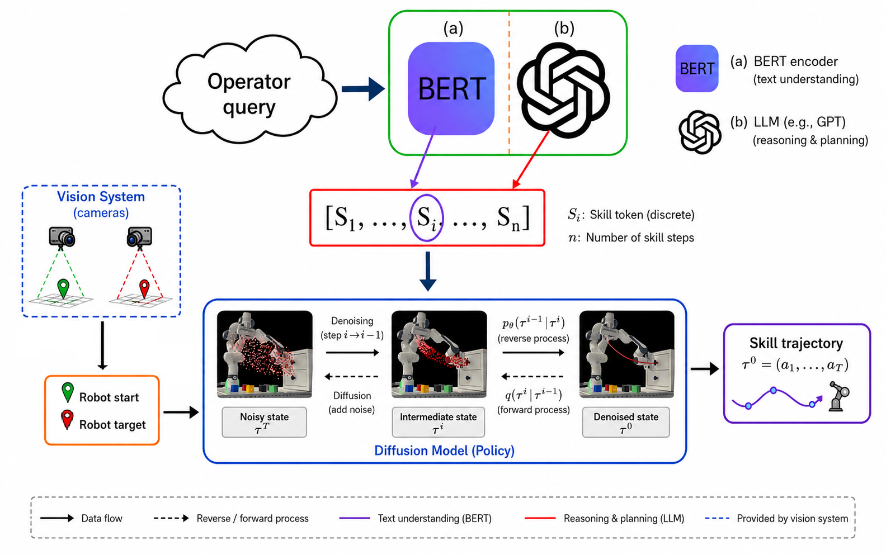

# DROM: A Language-Guided Diffusion Framework for Multi-Skill Robotic Manipulation



## Abstract

Learning robust manipulation policies for diverse, long-horizon tasks from limited demonstrations remains a fundamental challenge in robotics.
We present DROM, a language-guided diffusion framework that enables robots to learn, represent, and compose multiple manipulation skills within a single generative policy.
DROM leverages Dynamic Movement Primitives (DMPs) to augment a small set of expert demonstrations into expressive multi-skill datasets, substantially reducing data collection while improving spatial generalization beyond the demonstrated workspace.
Building upon Motion Planning Diffusion (MPD), we extend the diffusion architecture to support language-conditioned multi-skill trajectory generation through cross-attention, allowing a single model to generate skill-consistent motions for a diverse set of manipulation primitives, including orientation-sensitive behaviors that are difficult to design using conventional motion planning or hard-coded controllers.
For long-horizon manipulation, a large language model decomposes high-level operator requests into executable sequences of skills, enabling natural language interaction and autonomous task execution.
We validate DROM on a Franka Emika Panda robot, a FANUC CRX25ia robot, and in MuJoCo simulation across a wide range of manipulation tasks.
Experimental results demonstrate that DROM outperforms Motion Planning Diffusion and Behavior Cloning baselines, achieves robust multi-skill generalization, and composes learned skills to reliably execute long-horizon manipulation tasks from natural language instructions using only a limited number of human demonstrations.

## Requirements

- Linux, Python >= 3.8
- An NVIDIA GPU with CUDA support (training and rollout sampling are GPU-accelerated)

Python dependencies (installed automatically, see [setup.py](setup.py)) include `robosuite`, `mimicgen`, `diffusers`, `torch`, and `egl_probe` for rendering.

## Installation

```bash
git clone https://github.com/automation-robotics-machines/drom_public.git
cd DROM
source install.sh
```

`install.sh` creates a virtual environment in `.env`, installs the `drom` package and its dependencies, and installs PyTorch with CUDA 12.8 support. Activate the environment in future sessions with `source .env/bin/activate`.

## Usage

### Train the Diffusion Model

```bash
python drom/scripts/train_drom.py --config drom/configs/low_dim/drom.json
```

Training configurations live under [drom/configs](drom/configs) (`low_dim/` and `image/` variants). Edit a config to point `train.data` at your own dataset(s) and language-conditioning prompts, or copy one as a starting point for a new experiment.

### Evaluate the trained policy

```bash
python drom/scripts/test_drom.py \
  --directory <path-to-trained-model-dir> \
  --validations 30 \
  --seed 30 \
  --render
```

Key arguments:

| Argument | Description | Default |
|---|---|---|
| `--directory` | Path to the trained model directory (containing `config.json` and checkpoints) | required |
| `--ckpt` | Checkpoint name, or `last` to use the most recent checkpoint | `last` |
| `--seed` | Random seed for evaluation | `30` |
| `--samples` | Trajectories sampled per validation case | `10` |
| `--validations` | Number of validation cases to run | `5` |
| `--camera` | Camera view used for rendering | `frontview` |
| `--render` | Enable rendering of rollouts | off |

## Repository structure

```
drom/
├── configs/         # Experiment configs (low_dim and image observation variants)
├── datasets/        # Dataset loading and normalization
├── demos/           # Folder to store acquired/generated demonstrations
├── models/          # Diffusion model, language-conditioning, and policy architectures
├── losses/          # Diffusion training losses
├── trainer/         # Training loop and data loaders
├── scripts/         # Entry points: train, test scripts
├── plotting/        # Trajectory and rollout visualization
└── utils/           # Shared helpers (HDF5 I/O, seeding, W&B logging, etc.)
```

## License

This project is licensed under the [Apache License 2.0](LICENSE).

## Contact

For questions or issues, please open a GitHub issue or contact Vincenzo Pomponi (vincenzo.pomponi@supsi.ch).
